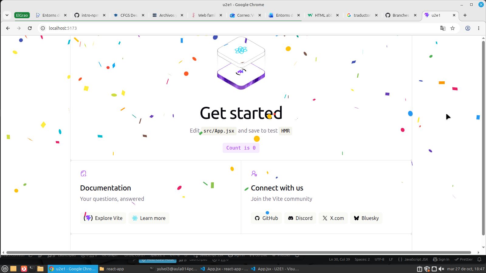
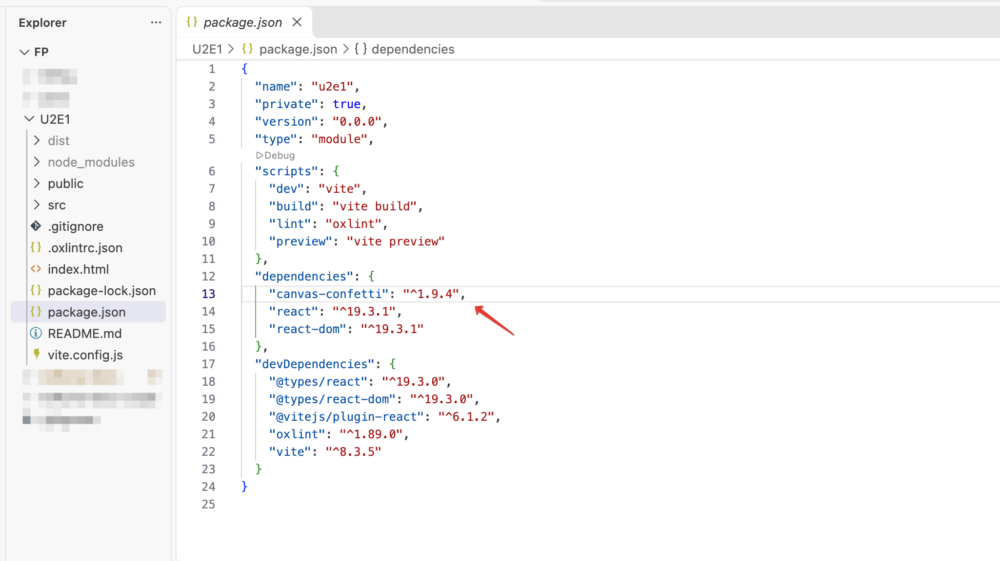
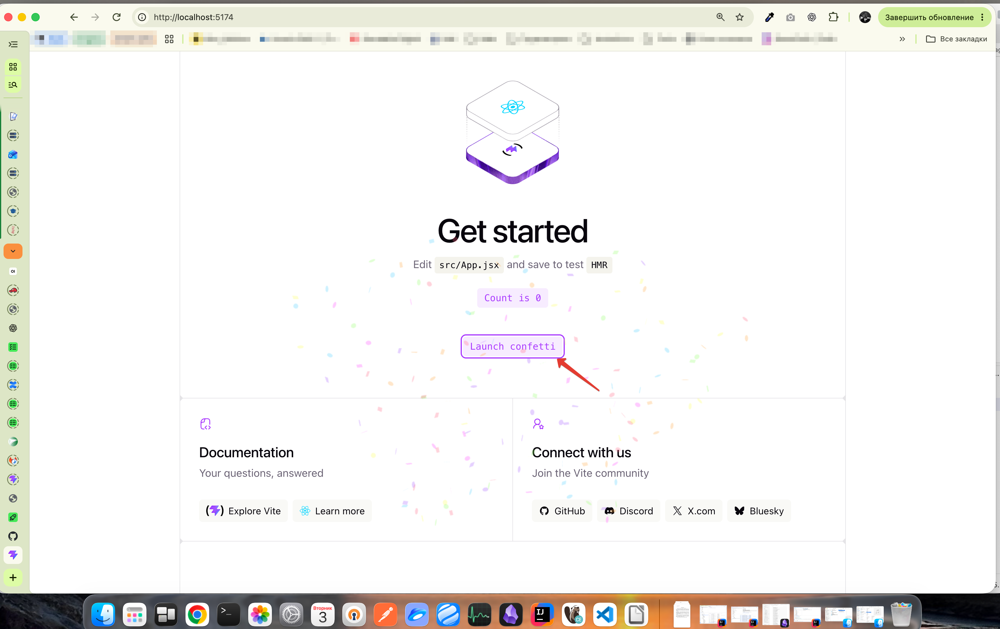
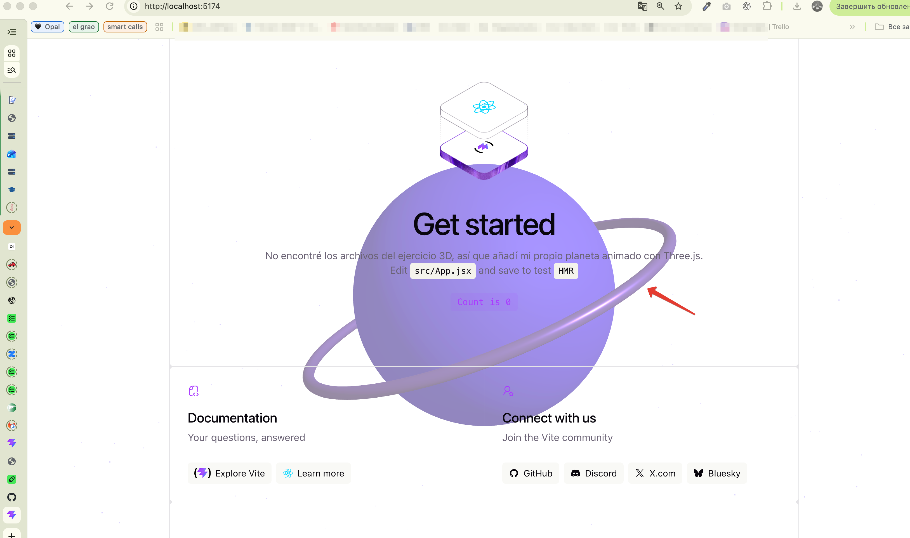

# Actividad npm + React + Git

Proyecto creado con Vite, React y JavaScript para practicar npm, ramas de Git y componentes.

## Capturas

### React Confetti

### Canvas Confetti

### Escena 3D

## Dependencias y Git

Aunque la carpeta `node_modules/` está excluida de Git, borrar una dependencia sí cambia el repositorio: se actualizan los archivos `package.json` y `package-lock.json`. Git guarda esos cambios, pero no los archivos instalados dentro de `node_modules/`.

## Web desplegada

La URL de GitHub Pages se añadirá aquí después del despliegue.
